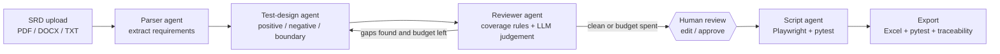

# SRD → Test Cases: Multi-Agent QA Assistant

Upload a Software Requirement Document and a team of LangGraph agents turns it into a reviewed, traceable test suite:
an Excel workbook, a Playwright + pytest automation suite, and a requirement-to-test traceability report.

**Stack:** Python · LangGraph · LangChain · Groq (Llama 3.3 70B, free tier) · Pydantic · Streamlit · openpyxl · pytest

## Problem

Writing test cases from an SRD takes QA teams days, and coverage gaps (missing negative and boundary cases) are
found late. This project automates the first draft **and** audits its own coverage, while keeping a human in control.

## Architecture



| Agent | Responsibility |
|---|---|
| Parser | Chunks the SRD, extracts typed, prioritised, testable requirements (structured output) |
| Test-design | Writes positive, negative and boundary tests per requirement; on revision only fills the flagged gaps |
| Reviewer | Deterministic checks (requirement without tests, functional requirement without negative tests) plus an LLM quality review |
| Human checkpoint | Graph pauses (`interrupt_before`); the user edits the test table; edits are written back into graph state |
| Script agent | Generates runnable pytest + Playwright code, validates it with `ast.parse`, falls back to a deterministic template |

### Design decisions worth discussing
- **Structured outputs everywhere** (Pydantic schemas) instead of parsing free text.
- **Hallucination guard:** test cases referencing a non-existent requirement id are dropped.
- **Bounded loop:** `MAX_REVISIONS` caps reviewer iterations so cost and latency stay predictable.
- **Targeted revisions:** only flagged requirements are re-sent to the LLM, which saves tokens on the free tier.
- **Prompt library:** all prompts are named and versioned in `src/prompts.py`, not inline.
- **Human-in-the-loop:** AI drafts, a QA engineer approves, because test suites are accountable artifacts.
- **Graceful degradation:** LLM-generated code that fails to parse falls back to a template.

## Setup

```bash
python -m venv .venv && source .venv/bin/activate      # Windows: .venv\Scripts\activate
pip install -r requirements.txt
cp .env.example .env                                   # add your free key from https://console.groq.com/keys
streamlit run app.py
```

Headless run: `python cli.py eval/samples/login_module.txt`

To run the generated automation: `pip install pytest-playwright && playwright install chromium && pytest outputs/<run>/test_generated.py`

## Evaluation

Three sample SRDs with keyword-based ground truth live in `eval/`.

```bash
python -m eval.evaluate        # writes eval/results.md
```

Metrics: requirement recall, coverage, negative-test ratio, tests per requirement, revisions needed.
Offline wiring tests (no API key needed): `pytest tests -q`

## Project layout

```
app.py              Streamlit UI with human-in-the-loop editing
cli.py              headless runner
src/agents.py       the agent nodes
src/graph.py        LangGraph wiring and routing
src/prompts.py      prompt library
src/schemas.py      Pydantic schemas and graph state
src/exporters.py    Excel / pytest / traceability exporters
src/llm.py          Groq client and retrying structured-output helper
eval/               sample SRDs, ground truth, evaluation script
tests/              offline tests with a fake LLM
docs/design_note.md one-page design note
```

## Limitations and next steps
- Generated Playwright selectors are guesses (marked `TODO`) and need alignment with the real app.
- Evaluation recall uses keyword matching, a rough proxy; an LLM-as-judge or labelled data would be stronger.
- Next: persistent checkpointer (SQLite) so runs survive restarts, image/diagram understanding for SRDs with figures,
  and a Jira/TestRail export.
